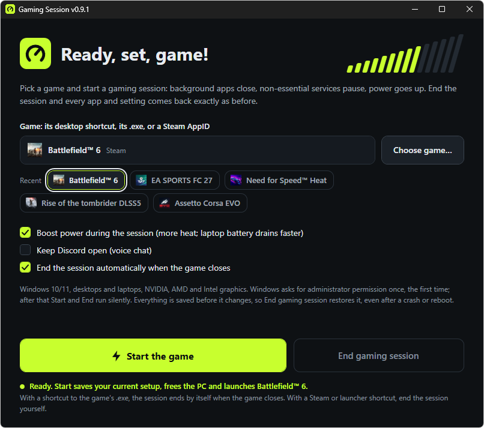

# Gaming Session

One-click gaming boost for Windows 10 & 11. Pick a game, press Start. End the session to restore what was changed.

**Website:** https://gamingsession.cyrille-pillon.com



## Download

Latest: **[v1.0](https://github.com/Cyr79/gaming-session/releases/latest)** — single `.exe` (131 KB), no installer.

SHA-256: `30D312AA9BF817ACEA62200B5E107DC0769AF06EB962206304F945723A6C2613`

Check it in PowerShell:

```powershell
Get-FileHash .\GamingSession-1.0.exe -Algorithm SHA256
```

The file is not code-signed yet, so Windows SmartScreen may warn on first launch ("More info" → "Run anyway").

## What it does

- Closes background apps so the game gets the RAM
- Pauses non-essential services while you play
- Runs a higher-power session (more heat; laptop battery drains faster)
- Saves your setup first, so "End gaming session" can restore it

Works with NVIDIA, AMD and Intel graphics, on desktops and laptops. Windows asks for administrator permission once, the first time.

## Before you test

This is experimental freeware. Save your work, back up important files and create a Windows restore point first. Results vary and full restoration is not guaranteed.

- [Tester terms & disclaimer](https://gamingsession.cyrille-pillon.com/terms)
- [Privacy policy](https://gamingsession.cyrille-pillon.com/privacy)

## Feedback

Found a bug? Open an [issue](https://github.com/Cyr79/gaming-session/issues). Do not include passwords or private files.

## About

Made by [Cyrille Pillon](https://cyrille-pillon.com). The source code is not published. See [LICENSE](LICENSE).
